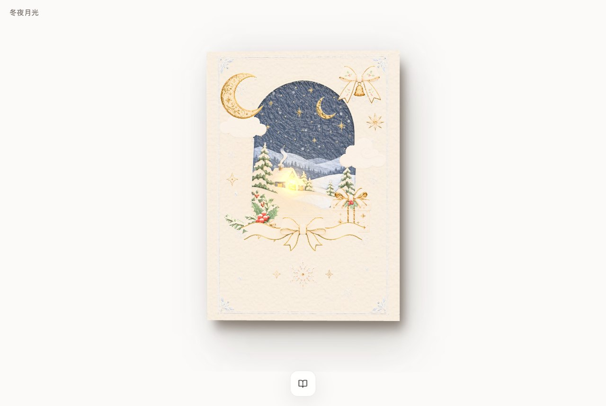
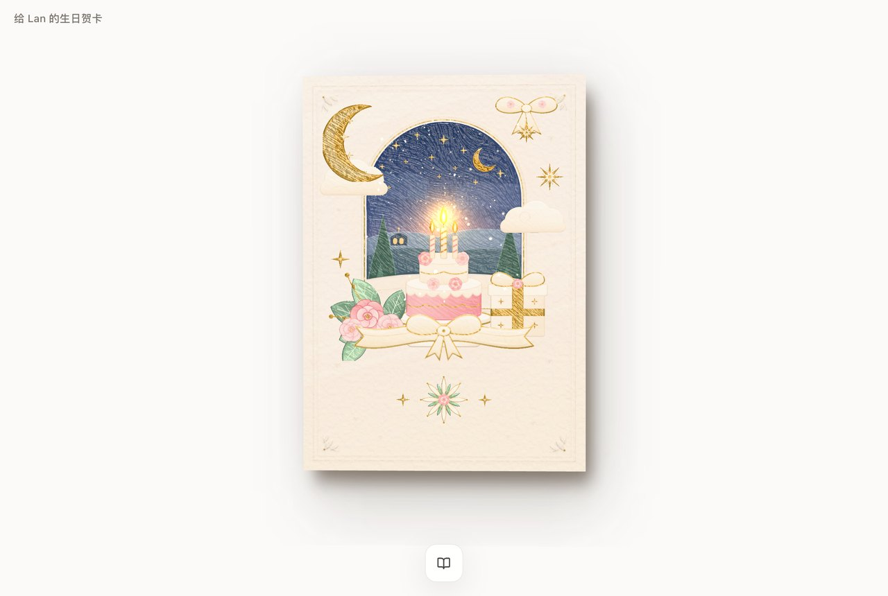
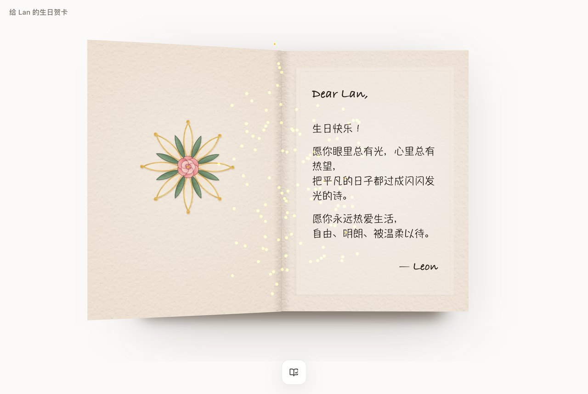

<h1 align="center">3d-card-master</h1>

<p align="center">
  本地 AI 制作 3D 纸雕互动贺卡的 Claude Code / Codex Skill：挑好主题、写下祝福、烘焙冷压棉纸浮雕与烫金，生成完全离线可打开的独立 3D 贺卡目录。
</p>

<p align="center">
  
</p>

<p align="center">
  <a href="https://3dcards.theliang.com/"></a>
  <a href="LICENSE"></a>
</p>

> **源码许可 / Source terms:** 源码与内置美术素材仅授权非商业学习、修改与分发；禁止商业使用、商业产品集成、广告和品牌项目。Source and bundled artwork are available for noncommercial use only and are not OSI-approved open-source software. See [LICENSE](LICENSE).

## 效果预览 / Preview

<table>
  <tr>
    <td align="center" width="50%">
      <br />
      <sub>定制主题示例：替换封面插画、丝带与多层纸雕元素</sub>
    </td>
    <td align="center" width="50%">
      <br />
      <sub>翻开内页：三槽手写祝福、左页压印徽章与暖金星火</sub>
    </td>
  </tr>
</table>

## 特性

- **零 CDN、完全离线** —— 内置 Three.js 与手写字体子集，生成的贺卡目录只需本地静态服务即可在浏览器中完整运行，不请求任何外部资源
- **多层 3D 纸雕与实时光影** —— 独立纸层厚度、软阴影、冷压棉纸颗粒浮雕法线、金属烫金（含柔和摄影棚反射高光）、指针跟随聚光灯
- **活卡片动效** —— 窗景暖光呼吸、元素轻晃（UV 微风形变）、可配置的飘雪 / 星火 / 花瓣粒子、拖拽旋转惯性与点击翻页弯曲
- **三槽手写内页** —— 称呼 / 正文 / 落款直接渲染在 3D 内页纸面上，支持中文、英文与混排手写体
- **自带换图与烘焙工具链** —— 提供品红/棋盘背景抠图脚本 `cutout_element.py` 与法线/烫金烘焙脚本 `bake_card.py`，可把任意主题插画做成同等质感的新卡片

## 安装与使用方法

### 方式一：在 Claude Code / Codex 中作为 Skill 使用（推荐）

- **本仓库内直接使用**：克隆仓库后，Claude Code 会自动识别 `.claude/skills/3d-card-master`
- **全局安装到本机**：将本目录复制到用户级 skills 目录：

```bash
cp -r .claude/skills/3d-card-master ~/.claude/skills/3d-card-master
```

之后直接向 AI 提需求即可触发，例如：

- 快速改文字（复用内置「冬夜月光」素材）：
  > 用 `3d-card-master` 给小美做一张冬夜圣诞贺卡，祝福语写「愿今年冬天也被温柔照亮」，落款「Leon」，输出到 `./for-xiaomei`。
- 定制全新主题（生日 / 新年 / 感谢 / 樱花等）：
  > 用 `3d-card-master` 给 Lan 做一张生日贺卡，保留窗框纸雕结构，把小屋换成三层奶油蛋糕和烛光，飘雪换成金色星火。

### 方式二：通过脚本直接生成与预览

1. **生成一张带默认「冬夜月光」美术的贺卡目录**：

```bash
python3 .claude/skills/3d-card-master/scripts/create_card.py ./my-card \
  --title "冬夜月光" \
  --greeting "Dear Friend," \
  --message "愿你在这个安静的冬夜里，心里有光，手里有暖。" \
  --signature "— Leon"
```

2. **在本地浏览器预览**（`file://` 下 ES Modules 会被浏览器拦截，请通过本地 HTTP 服务打开）：

```bash
python3 -m http.server 8000 --bind 127.0.0.1 --directory ./my-card
# 打开 http://127.0.0.1:8000
```

3. **随时修改祝福文字**：直接编辑 `./my-card/card.json` 并刷新页面即可：

```json
{
  "title": "冬夜月光",
  "greeting": "Dear Friend,",
  "message": "愿你在这个安静的冬夜里，心里有光，手里有暖。",
  "signature": "— Leon"
}
```

可选样式字段：
- `font`：手写字体族覆盖（默认与主站手写体一致，兼顾英文与中文手写感）
- `ink`：墨水颜色（默认 `#1f1916`）

### 方式三：替换插画、定制全新主题

若要替换内置素材做新主题（如生日、新年、周年纪念），流程详见 [references/paper-art.md](references/paper-art.md)，核心工具脚本如下：

```bash
# 1. 从纯品红 (#FF00FF) 或棋盘格背景中抠出透明元素图（需要 Pillow + numpy）
python3 .claude/skills/3d-card-master/scripts/cutout_element.py raw-cake.png ./my-card/art/elements/cake.webp

# 2. 烘焙冷压棉纸法线图与粗糙度/金属度贴图（含烫金自动识别）
python3 .claude/skills/3d-card-master/scripts/bake_card.py ./my-card/art
```

通过编辑 `./my-card/art/layout.json` 可以调整：
- 封面层叠元素位置、缩放、厚度与旋转
- `glow`（窗景暖光位置与脉冲强度）
- `particles`（`snow` 飘雪 / `gold` 星火 / `petals` 花瓣，或设 `null` 关闭）
- `live`（各元素的微风晃动幅度、周期与锚点）

## 交互说明

- **单击卡片** 或 **点击底部翻页按钮**：翻开 / 合上贺卡
- **按住拖拽**：360° 观察卡片厚度、棉纸浮雕与烫金反光（松手带柔和惯性）
- **移动鼠标**：指针跟随暖光掠过封面，激发纸纹与烫金高光
- **键盘**：`Enter` / `Space` 翻开或合上，`Escape` 合上

## 目录结构

```text
3d-card-master/
├── SKILL.md                 # Skill 入口说明与工作流规范
├── README.md                # 本说明文档
├── LICENSE                  # PolyForm Noncommercial 1.0.0 许可协议
├── references/
│   └── paper-art.md         # 纸雕分层美术、抠图、烘焙与验收指南
├── scripts/
│   ├── create_card.py       # 脚手架生成脚本（仅使用 Python 标准库）
│   ├── cutout_element.py    # 品红/棋盘背景透明抠图脚本
│   └── bake_card.py         # 棉纸法线 + 烫金 PBR 贴图烘焙脚本
└── assets/
    ├── previews/            # README 预览截图（不会复制到生成的卡片中）
    └── template/            # 独立离线 3D 贺卡模板（含冬夜月光素材、Three.js 与字体）
```

## 素材与第三方说明

- **内置「冬夜月光」卡片插画与 3D 渲染模板**：来自 [christmas-cards](https://github.com/dongliang1993/christmas-cards) 主项目，随 Skill 以相同的非商业条款分享，不得单独商用
- **Three.js**（`assets/template/vendor/three.*.min.js`）：MIT License，见 [assets/template/vendor/LICENSE](assets/template/vendor/LICENSE)
- **字体**（`assets/template/vendor/fonts/`）：Caveat、Long Cang（Google Fonts），SIL Open Font License 1.1，见 [assets/template/vendor/fonts/OFL-NOTICE.txt](assets/template/vendor/fonts/OFL-NOTICE.txt)

## License

[PolyForm Noncommercial License 1.0.0](LICENSE) —— 可自由用于学习、研究、修改与**非商业**再分发；**不允许商业用途**。所有副本、打包分发与生成的模板衍生作品均须保留 `LICENSE` 中的 `Required Notice`（`christmas-cards © 2026 dongliang`）。

本站名称、品牌标识与卡片美术不授权用作其他产品的品牌标识。
